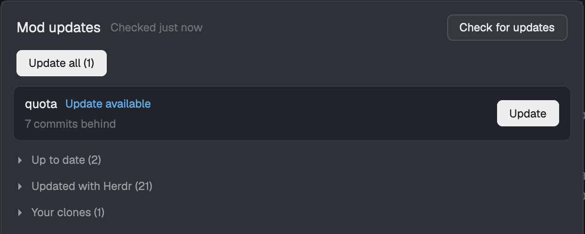

# Mod updates

A dialog that lists every mod in your Herdr app and says which ones have updates. Mods that need you
get a row with a status and a button: Update, Link source or Retry. Mods that are fine fold away
under Up to date, Updated with Herdr and Your clones. Update all at the top installs every waiting
update, one at a time, and each row shows how far it has got. A mod with local edits asks before
they're replaced. The dialog is the front end of the `hmod` command-line tool, and it says how to get
that tool until it's installed.

## What you see

A dialog overlay 620px wide and 80% of the window tall, on the `popover` background, base type 13px.
Every color here is a `theme()` name, so it follows the theme. Top to bottom:

- **Header**, 16px side padding, 14px above, 10px below, 10px gap between its two lines.
  - First line: `Mod updates` at 15px semibold `foreground`. Beside it, filling the middle and
    truncated, the status at 12px `dim`: `Checked 5m ago` (`just now`, `Nm ago`, `Nh ago` up to 48
    hours, then `Nd ago`), `Not checked yet`, `Checking…`, `Checking before updating…` or
    `Updating…`, and nothing in the not-set-up state. At the right, the **Check for updates** button.
  - Second line: the primary button `Update all (N)`, where N counts mods with an update. Disabled
    at 0.
- **Not-set-up notice**, only when the CLI can't be run. 16px side padding, 10px below, 4px gap,
  12px `dim`: `Mod updates needs the hmod CLI. Install it, then run hmod mod install.`, then the URL
  `https://github.com/jonathan-fielding/herdr-mod-updater` in `muted`, `foreground` under the
  pointer.
- **Error line**, when the last load or job failed: the error, 12px `blocked`, 16px side padding,
  10px below.
- **Rate-limit line**, when the last check hit GitHub's limit, 12px `dim`, same padding:
  `GitHub's rate limit lifts <time>: some mods couldn't be checked.`
- **The list** fills the rest, scrolling, 10px below.

Buttons are 28px tall, 12px side padding, radius 6, 1px border, 12px type. Plain: `raised` background,
`input` border, `foreground` text. Primary: `solid` background and border, `solid_foreground` text.
Disabled: 50% opacity. Under the pointer an enabled button goes to 88% opacity.

In the list, top to bottom:

- **Summary card**, after an update job. 12px side margin, 10px below, 12px padding, 4px gap, radius
  8, 1px `border`, `raised` background. A medium `foreground` line such as `2 updated · 1 failed ·
  1 skipped` (`Nothing to update` if there were none), with a `✕` at the right in `dim`, `foreground`
  under the pointer. Under it at 12px: the job's error and each failure in `blocked`, each note in
  `foreground`, then `Skipped <mod>: <reason>` in `muted`.
- **`Nothing needs you.`**, in `muted`, 16px side padding, 10px vertical, once loaded with no
  attention rows and no summary.
- **Attention rows**: 12px side margin, 6px below, 12px side and 8px vertical padding, radius 8, 1px
  `border`, `background` fill. The title in medium `foreground`, truncated; beside it the status word
  at 12px; under them a 12px `dim` detail line if there's one; at the right the button.

  | Status word | Color | Detail line | Button |
  |---|---|---|---|
  | `Update available` | `accent` | `1.2.0 → 1.3.0 · 2 commits behind` | primary `Update` |
  | `Edited locally` | `blocked` | up to 3 changed files, then the versions, `An update exists` or `No update to install` | `Update`; none if nothing newer is known |
  | `No source known` | `muted` | `N possible sources found`, or `Where this mod came from isn't known` | `Link source` |
  | `Error` | `blocked` | the message | `Retry`, which runs a check |
  | `Waiting` | `dim` | the versions | none |
  | `Updating`, `Updating: downloading` (also checking, backing up, installing, verifying, pulling) | `working` | the versions | none |
  | `Updated` | `done` | `Now at 1.3.0` | none |
  | `Already up to date` | `done` | the versions | none |
  | `Failed` | `blocked` | the error | `Retry` |
  | `Skipped` | `muted` | the reason | as for the mod's status |

  `Version 1.2.0` replaces the arrow when no newer version is named, and `+` follows a commit count
  that's only a floor.
- **Link panel**, inside a row whose Link source is open. 8px above, 8px gap, 12px type. One line for
  each possible source: `owner/repo · path` in `foreground`, truncated, the reason why under it at
  11px `dim`, and a `Link` button. Then an input 28px tall, radius 6, `background` fill, `input`
  border, placeholder `owner/repo`, with a `Link` button. A link error under it in `blocked`.
- **Folded sections**, in this order: `Up to date (N)`, `Updated with Herdr (N)` and `Your clones (N)`,
  each hidden when empty. Heads are 28px tall, 12px `muted`, `foreground` under the pointer, with `▸`
  or `▾`. Open, each mod is a 24px line, 12px type: the title in `foreground` and its version in
  `dim` at the right.

**The ask dialog** is a second overlay, 460×260, on `popover`, 18px padding, 12px gap. `Update
<title>?` at 15px semibold, with `Esc` at 11px `dim` at the right. Then in `muted`:
`Your edits to main.js, mod.json will be replaced with the newest version from owner/repo.` (up to 4
files, then `and N more`), and `A backup of the mod as it is now will be kept in
~/.herdr-mod-updater/backups.` Then `Cancel` and the primary `Update and keep a backup`, right
aligned, with any error above them in `blocked`.

## How it behaves

It shows no agent statuses. Its statuses are the mods': `herdr`, `up_to_date`, `update_available`,
`modified`, `unlinked` and `error`, as the rows above show them. An installed `mod-updater` is
treated like hcoord: Up to date, or Update available when its clone's origin is ahead. A plain copy
that isn't set up is `unlinked` and is never shown.

- **Opening** reads `hmod check --cached --json`, which needs no network, so the list appears at once.
  If a job is running, the dialog picks it up. If not, and the last check was more than 6 hours ago or
  never, it starts a check by itself.
- **Which rows show**: `update_available`, `modified`, `error`, `unlinked` unless it's the person's
  clone or `mod-updater`, and any mod the current job has a state for. The rest fold away.
- **Check for updates** starts a job. The status reads `Checking…`, then `Checked just now`, and the
  rows change. A finished check that found new links shows them as ordinary rows.
- **Update** starts a job for that mod. Its row walks through the steps. Everything else is disabled
  until the job ends, then the list reloads and the summary card shows.
- **Update on an `Edited locally` row** opens the ask dialog. `Update and keep a backup` starts the
  job with `--force` from there and closes it, and the list behind picks the job up. `Cancel` or Esc
  closes it and nothing changes.
- **Update all** starts a job that checks first (`Checking before updating…`), then rows go to
  `Waiting` or `Skipped` and are updated in turn by name. A failure doesn't stop the rest. Modified,
  unlinked and error mods are skipped.
- **Link source** opens that row's link panel, and clicking again closes it. `Link` on a possible
  source links it. Typing `owner/repo`, `owner/repo/mods/name` or a GitHub URL of either, then Enter
  or `Link`, links that. A bad entry says `Type the repo as owner/repo.`, and a refusal from the CLI
  shows under the input. A link that works starts a check.
- **Closing the dialog** leaves a job running. Reopening shows it where it has got to.
- **Close the summary** with `✕`, which also clears the rows' job states.
- `Checked 5m ago` moves on by itself every 30 seconds.
- If the CLI goes missing mid-job (exit 126 or 127, or Bun can't find `cli.ts`), the setup notice shows.
  A job whose process dies shows `hmod stopped before it finished`, and any row it hadn't reached is
  `Failed`. If a job's log doesn't show that job within 10 seconds, the error line says `hmod didn't start.`

**The status bar button.** With `{"bar": true}` in a layout block's props, the mod draws one clickable line instead of the dialog: `Mod updates`, or `Mod updates (N)` in `foreground` when N mods have an update, on `chrome` with a top border, 11.8px. A click runs `mod.open`. It rereads `hmod check --cached --json` once a minute and never starts a check.

## Built from

- `mods/mod-updater/main.js`: one default-export `View`, class `ModUpdates`. It imports `View`, `div`
  from `gpui-kit`, `v_flex`, `h_flex`, `InputState`, `Input` from `gpui-base`, and `exec`,
  `readTextFile`, `theme`, `home`, `props`, `openOverlay`, `closeOverlay`, `shared`, `setShared` from
  `herdr`.
- `mods/mod-updater/mod.json`: `{ "place": "none", "title": "Mod updates", "overlay": { "kind":
  "dialog", "width": 620, "height": 0.8 } }`.
- `mods/mod-updater/hmod-path.js`: `export const HMOD = null;` and `export const HMOD_DATA = null;` as
  committed; see Watch out.
- `keys.json` at the repo's root: `cmd-shift-u` and `ctrl-shift-u` in `global`, both
  `mod.open:mod-updater`.
- One mod plays two roles, chosen by `props()?.ask` in `init` and `render`:

  | Prop | Role | Opened with |
  |---|---|---|
  | `ask` | the ask dialog; `{ mod, title, changed, repo }` | `openOverlay`, `kind: "dialog"`, 460×260 |
  | none | the list | `mod.open {name: "mod-updater"}` |

- It's built on no layout and uses no shipped mods or art. It adds no block to a layout.
- `shared` keys: `mod-updater.job` (the newest job's id) and `mod-updater.seen` (the newest one
  finished showing). A job is running while they differ.
- **Short commands** go through `exec`: `hmod check --cached --json` and `hmod link <mod> <repo>
  [--path p] --json`.
- **Long commands** are jobs, because `exec` stops a program after 30 seconds and returns output only
  at the end. `exec("/bin/sh", ["-c", START, RUNNER, log, header, ...HMOD, ...args])` empties
  `<HMOD_DATA>/mod-job.log`, then starts a `nohup` shell writing to it and returns. The log's first
  lines are `{"event":"job","id","kind","mod"}` and `{"event":"pid","pid"}`, then hmod's `--json`
  output, and the last is `{"event":"exit","code"}`. A 500ms timer rereads the log and works the
  rows out from the start each time. Every 10th read, `kill -0 <pid>` looks for the process. The jobs
  are `hmod check --json`, `hmod update --all --json` and `hmod update <mod> [--force] --json`.
- **The CLI**, `src/`, on Bun with no runtime dependencies: `hmod list`, `check [--cached]`, `link`,
  `unlink`, `update <mod> [--force]`, `update --all` and `mod install`, each with `--json`.
  - Comparing files: git blob SHAs of everything except dotfiles, `gpui-kit.d.ts` and `jsconfig.json`.
  - Inventory: folders in `<herdr home>/mods`. Keys of `installed.json` without a `:` are `herdr`. A
    `.hcoord-installed` file marks hcoord, and `.hmod-installed` this mod. `cloned_from` in `mod.json` marks a `mod.clone` copy.
  - Finding a source: GitHub search for `<name or title> topic:herdr-mod fork:true`, up to 20 repos,
    best name first. For each, the folder under `mods/` that fits, a `HEAD` on the blobs to skip repos
    with no matching file, then the 30 newest commits to that folder. One repo with every file equal
    links. Otherwise up to 5 suggestions.
  - Updating: refuse symlinks, submodules and unsafe paths, stage and hash the files, `herdr-app
    check`, back up, write each file through a temp file and rename with `main.js` last, verify,
    `herdr-app check` again, record the baseline, or restore from the backup. Keeps 3 backups per mod.

## Watch out

- **What this mod reaches.** Before adding it, tell the person:
  - Network: the mod makes no network requests itself; the setup link opens in the browser. The CLI
    it runs reads `https://api.github.com` to search repos and fetch mods' files, sending the mods'
    names and titles and files' SHAs. For hcoord and this mod it runs `git fetch` and `git pull`
    against the clone's origin.
  - Programs: the mod's `exec` runs `bun` with the hmod CLI, and `/bin/sh` for jobs and `kill -0`. It
    doesn't use `hc`. The CLI runs `gh auth token`, `herdr-app check`, `git`, and for hcoord and this
    mod the command in `hcoord-path.js` or `hmod-path.js` with `mod install`.
  - Files outside its folder: the mod reads `~/.herdr-mod-updater/mod-job.log`, and its shell writes
    it. The CLI reads `~/.config/herdr-app/installed.json`, reads and writes other mods' folders in
    `~/.config/herdr-app/mods/` (that's the point of it: **it replaces their files with code from
    GitHub**, which then runs in the app), reads and writes `~/.herdr-mod-updater/`, and pulls in the
    person's hcoord clone and its own. `hmod mod install` writes `mods/mod-updater/`.
  - It uses the person's GitHub token from `gh`, sent only to GitHub, not stored. It doesn't watch
    any folders.
- **`hmod-path.js`**. The repo's copy says `HMOD = null`, so a plain copy loads, shows the notice and
  runs nothing. `hmod mod install` writes the exact bun and `cli.ts` into the installed copy only, with
  `HMOD_DATA`. `exec` takes no environment, so non-default homes go through `/usr/bin/env` in the argv.
- **Never let GitHub's copy land on an installed `mod-updater`**: the blank `hmod-path.js` would replace
  the real one. `.hmod-installed` makes it clone-installed, so linking it is refused and an update pulls
  the clone and runs `hmod mod install`. That install ignores a shell's `HMOD_HOME`, so only the
  generated argv decides the data folder.
- **Never take a link's baseline from disk**: it could be edits, and an update would then replace them
  unasked. `hmod link` stays offline and records no baseline. The first check compares the local files
  with the folder's last 30 commits. A match is the baseline. Otherwise the mod is `modified` against
  HEAD with `update_available` true, marked `baseline_assumed` so a forced update still installs when
  HEAD equals that baseline. An update does this first if no check has, and refuses if it can't.
  A failed check is `error`, never clean.
- **`--json` shapes are a contract** between the CLI and the mod: add fields, don't rename them.
- **Empty the log before starting a job**, in the shell that returns first. Otherwise a poll can read
  the last job's lines as this job's. The id in the header is what tells them apart.
- **A half-written log line** fails to parse. Hold it aside and only count it once the job has ended.
- **Install `main.js` last**: Herdr reloads on each save, and it imports the rest.
- **A rename that only changes case** leaves one file on most Macs, so removing the old name loses it.
  Compare inodes first.
- **Real GPUI is stricter than `herdr-app check`**, which doesn't run later states such as rows that
  arrive after a load. `flex_shrink()` with no number throws there and crashes a row, so use
  `flex_shrink_1()`. Try it in the app with real rows.
- **Limits**: the 30-commit walk means an install older than that isn't matched. `hmod link` takes any
  branch, but the dialog's link box doesn't. `keys.json` is never merged. GitHub's rate limit stops a
  check part way and the rest show as errors; `gh auth login` raises it. macOS only, as built.
- **Assumes**: Herdr with `herdr-app` on the login shell's `PATH`, git, and Bun. `gh` is optional.

## Done when

- `herdr-app check ~/.config/herdr-app/mods/mod-updater` passes with `HMOD = null`.
- Opened with `HMOD = null`, the dialog shows the notice and the URL, both buttons are disabled, and no
  `hmod` process runs.
- After `hmod mod install`, `herdr-app do mod.open --name mod-updater` opens the dialog at 620px, and
  running it again closes it. `hmod mod install` refuses a folder that isn't hmod's, and takes over a
  plain copy.
- `hmod list --json` gives `herdr` for a mod in `installed.json`, whose row is under Updated with Herdr
  and has no button.
- With a mod whose files equal an old commit in exactly one `herdr-mod` repo, `hmod check` links it and
  it shows `Update available` with versions and commits behind.
- With the same files in two repos, it stays `No source known` with two offers. `Link` on one links it.
- A mod with an edit shows `Edited locally`, the changed file, and is skipped by Update all.
- Update on a mod replaces its files, leaves `gpui-kit.d.ts`, `jsconfig.json` and dotfiles alone, leaves a
  backup, and the row ends `Updated`. `sources.json` holds the new commit.
- Update on an edited mod opens the ask dialog. Cancel changes nothing. Confirming replaces the edits, and
  the backup has them.
- A new version that fails `herdr-app check` changes nothing, and the row ends `Failed`.
- A new version that fails after installing is rolled back: the old files are back.
- Update all updates each mod in turn. With one failing, the others still update and the card counts both.
- Closing the dialog mid-update and reopening it shows the same job going, and it finishes.
- `hmod link mod-updater owner/repo` on an installed copy is refused and records nothing.
- With hcoord installed from a clone, Update runs `git pull --ff-only` and `hcoord mod install`, and a clone
  with uncommitted changes is refused with nothing changed.
- `bun test` and `tsc --noEmit` pass, and neither touches the real homes or the network.
